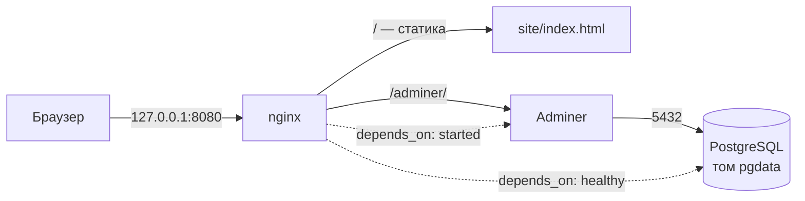

# docker-stand

Стенд на Docker Compose: PostgreSQL, nginx и Adminer — с томами, healthcheck и проверенным восстановлением из бэкапа.

## Что это

Три сервиса в одной сети Docker Compose: nginx, PostgreSQL 16 и Adminer. Наружу открыт только порт 8080, и по умолчанию он слушается на `127.0.0.1` — с другой машины стенд недоступен. Через этот порт nginx отдаёт статическую страницу и проксирует веб-клиент Adminer по адресу `/adminer/`. Сама база доступна только внутри сети контейнеров, а её данные лежат в именованном томе `pgdata`, поэтому переживают перезапуск и `docker compose down` (том удаляет только `docker compose down -v`).

Стенд учебный. Его задача — отработать резервное копирование и восстановление базы: именно это обычно проверяют на собеседовании по эксплуатации, а не красивый сайт. В репозитории есть база-магазин (24 товара в 3 категориях) и три скрипта: `backup.ps1`, `restore.ps1`, `check.ps1`.

**Это не продакшн.** Пароль в `.env.example` (`change_me`) нужно поменять перед любым использованием вне localhost: база работает под суперпользователем, TLS нет, бэкапы не шифруются.

Порт слушается только на `127.0.0.1`, поэтому с другой машины стенд не открывается. Если меняете привязку на `0.0.0.0` (например, чтобы зайти с другой машины), сначала смените пароль и поставьте TLS: у Adminer нет своей аутентификации, единственный барьер — логин БД, и порт, опубликованный наружу, откроет базу всей сети.

## Состав



| Сервис | Образ | Порт | Зачем |
|---|---|---|---|
| `nginx` | `nginx:1.27-alpine` | `127.0.0.1:8080` → `80` | отдаёт статику и проксирует `/adminer/` |
| `db` | `postgres:16-alpine` | `5432`, только внутри сети | PostgreSQL, данные в томе `pgdata` |
| `adminer` | `adminer:4` | `8080`, только внутри сети | веб-клиент к базе через `/adminer/` |

Пунктирные стрелки — не трафик, а зависимости запуска: nginx стартует после того, как `db` станет `healthy`, а `adminer` — запущенным. К базе nginx сам не обращается, но ждёт её намеренно: иначе страница открывалась бы раньше базы.

## Требования

- Docker Desktop с движком 24 или новее (проверялось на 29.9.3);
- плагин `docker compose`, версия 2 и новее (проверялось на v5.7.0);
- PowerShell 5.1 — только для скриптов из `scripts/`;
- около 1 ГБ свободной оперативной памяти.

Команды `docker compose` работают в любом терминале — PowerShell, cmd, bash. Вспомогательные скрипты `check.ps1`, `backup.ps1` и `restore.ps1` написаны под Windows PowerShell; на Linux или macOS вместо них выполняйте те же `docker compose exec`, `pg_dump` и `pg_restore` вручную — готовые строки есть в разделе «Linux и macOS».

В Windows политика по умолчанию запрещает выполнение `.ps1`, поэтому все три скрипта запускаются с обходом политики:

```powershell
powershell -ExecutionPolicy Bypass -File .\scripts\backup.ps1
powershell -ExecutionPolicy Bypass -File .\scripts\restore.ps1 -File .\backups\<ваш-дамп>.dump
powershell -ExecutionPolicy Bypass -File .\scripts\check.ps1
```

Без обхода `.\scripts\check.ps1` отвечает `выполнение сценариев отключено`.

## Запуск

```powershell
git clone https://github.com/XOLODVETRA/docker-stand.git
cd docker-stand
Copy-Item .env.example .env
docker compose up -d --wait
docker compose ps
```

`git clone` сам создаёт каталог `docker-stand`. В bash `Copy-Item .env.example .env` — это `cp .env.example .env`, остальные команды те же. `--wait` возвращает управление только когда все сервисы стали `healthy`; без него `docker compose ps` первые секунды показывает `health: starting`.

```text
NAME                     IMAGE                COMMAND                  SERVICE   CREATED          STATUS                    PORTS
docker-stand-adminer-1   adminer:4            "entrypoint.sh docke…"   adminer   20 seconds ago   Up 19 seconds (healthy)   8080/tcp
docker-stand-db-1        postgres:16-alpine   "docker-entrypoint.s…"   db        20 seconds ago   Up 19 seconds (healthy)   5432/tcp
docker-stand-nginx-1     nginx:1.27-alpine    "/docker-entrypoint.…"  nginx     20 seconds ago   Up 13 seconds (healthy)   127.0.0.1:8080->80/tcp
```

Имена контейнеров compose собирает из имени каталога, поэтому в вашем клоне они будут другими, если папка называется иначе. У nginx в колонке `PORTS` видно `127.0.0.1:8080->80/tcp`: порт слушается только на loopback.

Дальше откройте `http://localhost:8080` — там статическая страница стенда, и `http://localhost:8080/adminer/` — веб-клиент к базе (сервер `db`, логин и пароль из `.env`).

`docker compose down` останавливает стенд, данные в томе `pgdata` сохраняются; `docker compose down -v` удаляет их.

Без `.env` compose не стартует и подсказывает, что делать, — это ожидаемое поведение, а не поломка. Таких строк в выводе четыре, по одной на каждую переменную; первая:

```text
error while interpolating services.db.environment.POSTGRES_DB: required variable POSTGRES_DB is missing a value: Скопируйте .env.example в .env
...
```

## Проверки

```powershell
powershell -ExecutionPolicy Bypass -File .\scripts\check.ps1
```

Скрипт делает четыре проверки: все три контейнера запущены, сайт отвечает по HTTP, Adminer отвечает по HTTP, в таблице `products` ожидаемое число строк (по умолчанию 24). Код возврата 0 — всё прошло, иначе 1.

```text
[OK] Все контейнеры запущены: adminer, db, nginx
[OK] Сайт http://127.0.0.1:8080/ — код 200
[OK] Adminer http://127.0.0.1:8080/adminer/ — код 200
[OK] Таблица products: строк 24, ожидалось 24
Итог: 4 из 4 проверок пройдено
```

Проверка данных не декоративная: если база пустая или таблицы нет, четвёртый пункт падает и скрипт возвращает 1.

## Бэкап и восстановление

Дамп снимается одной командой:

```powershell
powershell -ExecutionPolicy Bypass -File .\scripts\backup.ps1
```

`backup.ps1` снимает дамп внутри контейнера `db` (`pg_dump -Fc`), проверяет его там же через `pg_restore -l` и только после этого копирует на хост в `backups/`. Имя файла — метка времени, поэтому старые дампы не перезаписываются, а у вас на машине имя будет своё. Вывод с машины, где снимался дамп:

```text
База: shop, пользователь: shop_user
Создаю дамп внутри контейнера db...
Проверяю дамп (pg_restore -l)...
docker-stand-db-1 Copying docker-stand-db-1:/tmp/backup.dump to .\backups\20261123-161113.dump
docker-stand-db-1 Copied docker-stand-db-1:/tmp/backup.dump to .\backups\20261123-161113.dump
Бэкап: .\backups\20261123-161113.dump (6979 байт)
```

Восстановление берёт конкретный файл. Чтобы не искать имя вручную, возьмите самый свежий дамп:

```powershell
$dump = Get-ChildItem .\backups\*.dump | Sort-Object LastWriteTime | Select-Object -Last 1
if (-not $dump) { Write-Host 'Дампов нет — сначала выполните .\scripts\backup.ps1'; return }
powershell -ExecutionPolicy Bypass -File .\scripts\restore.ps1 -File $dump.FullName
```

Если файл известен, укажите его явно: `-File .\backups\<ваш-дамп>.dump`. Скрипт спросит подтверждение, потому что перезаписывает базу; флаг `-Force` его отключает.

Чтобы показать, что восстановление действительно берёт данные из дампа, база была испорчена: схема `public` снесена целиком, вместе с таблицами.

```powershell
docker compose exec -T db psql -U shop_user -d shop -c "drop schema public cascade; create schema public;"
```

```text
NOTICE:  drop cascades to 2 other objects
DETAIL:  drop cascades to table categories
drop cascades to table products
DROP SCHEMA
CREATE SCHEMA
```

После этого `check.ps1` даёт 3 из 4 — данных нет:

```text
[OK] Все контейнеры запущены: adminer, db, nginx
[OK] Сайт http://127.0.0.1:8080/ — код 200
[OK] Adminer http://127.0.0.1:8080/adminer/ — код 200
[FAIL] Данные в базе: psql вернул код 1 — таблица products недоступна
Итог: 3 из 4 проверок пройдено
```

Восстановление (на вопрос подтверждения введено `y`):

```text
Восстановление перезапишет данные в базе 'shop'.
y
Файл: .\backups\20261123-161113.dump
Копирую дамп в контейнер db...
docker-stand-db-1 Copying .\backups\20261123-161113.dump to docker-stand-db-1:/tmp/restore.dump
docker-stand-db-1 Copied .\backups\20261123-161113.dump to docker-stand-db-1:/tmp/restore.dump
Проверяю дамп (pg_restore -l)...
Очищаю схему public...
DROP SCHEMA
CREATE SCHEMA
Восстанавливаю базу...
pg_restore код: 0
Восстановлено: products — 24, categories — 3
```

И `check.ps1` снова проходит целиком:

```text
[OK] Все контейнеры запущены: adminer, db, nginx
[OK] Сайт http://127.0.0.1:8080/ — код 200
[OK] Adminer http://127.0.0.1:8080/adminer/ — код 200
[OK] Таблица products: строк 24, ожидалось 24
Итог: 4 из 4 проверок пройдено
```

`restore.ps1` проверяет дамп до того, как что-то менять, и не верит коду `pg_restore` вслепую, но и не игнорирует его. Сначала дамп читается через `pg_restore -l`: битый файл отсекается до очистки схемы, данные остаются нетронутыми — `Fail : Дамп не читается: pg_restore: error: could not read from input file: end of file`. Потом скрипт сам сносит схему `public` и запускает `pg_restore --exit-on-error --no-owner`. Флага `--clean` больше нет: схема уже пустая, а предупреждения `--clean` об отсутствующих объектах и давали тот ненулевой код, которому нельзя было верить. Теперь ненулевой код — провал: скрипт печатает его в сообщении и возвращает 1. После восстановления проверяются два факта — в `products` больше нуля строк и в `categories` ровно 3; если что-то не так, скрипт называет проверку и код `pg_restore`. Проверено и обратное: дамп только со схемой (`pg_dump --schema-only`) даёт `Fail : Восстановление не удалось: проверка products не прошла — строк 0, ожидалось больше 0 (pg_restore код 0).` и код 1.

Если `pg_restore` упадёт посередине, база останется пустой: схема `public` уже снесена, а `--exit-on-error` остановил восстановление на первой ошибке. Просто повторите восстановление — поэтому дамп должен существовать на диске до запуска.

### Linux и macOS

Те же действия без PowerShell — по строке на шаг:

```bash
set -a; . ./.env; set +a
# бэкап
docker compose exec -T db pg_dump -U "$POSTGRES_USER" -d "$POSTGRES_DB" -Fc -f /tmp/backup.dump
docker compose cp db:/tmp/backup.dump "./backups/$(date +%Y%m%d-%H%M%S).dump"
# проверки
curl -fsS -o /dev/null -w '%{http_code}\n' "http://127.0.0.1:$STACK_PORT/"
docker compose exec -T db psql -U "$POSTGRES_USER" -d "$POSTGRES_DB" -tAc 'select (select count(*) from products), (select count(*) from categories)'
# восстановление: проверка дампа, снос схемы, pg_restore
docker compose cp "./backups/<файл>.dump" db:/tmp/restore.dump
docker compose exec -T db pg_restore -l /tmp/restore.dump
docker compose exec -T db psql -U "$POSTGRES_USER" -d "$POSTGRES_DB" -c 'drop schema public cascade; create schema public;'
docker compose exec -T db pg_restore -U "$POSTGRES_USER" -d "$POSTGRES_DB" --exit-on-error --no-owner /tmp/restore.dump
```

`set -a` экспортирует переменные из `.env`, чтобы `$POSTGRES_USER` и `$STACK_PORT` попали в команды; `set +a` возвращает обычное поведение. Каталог `backups/` должен существовать — `backup.ps1` создаёт его сам, ручной `docker compose cp` нет.

## Переменные окружения

Все значения берутся из `.env` в корне проекта; шаблон — `.env.example`. Значения пишите без кавычек: `POSTGRES_USER=shop_user`, а не `POSTGRES_USER="shop_user"`. Скрипты разбирают `.env` через `ConvertFrom-StringData` и кавычки не снимают, поэтому в `psql` уйдёт имя пользователя или базы вместе с ними, а `STACK_PORT` в кавычках даст кривой URL. `POSTGRES_PASSWORD` скрипты не читают вовсе — `psql` внутри контейнера подключается через локальный сокет, — так что кавычки вокруг пароля ломают только вход через Adminer.

| Переменная | По умолчанию | Зачем |
|---|---|---|
| `POSTGRES_DB` | `shop` | имя базы; создаётся при первом старте на пустом томе |
| `POSTGRES_USER` | `shop_user` | пользователь базы, он же суперпользователь |
| `POSTGRES_PASSWORD` | `change_me` | пароль; менять до любого использования вне localhost |
| `STACK_PORT` | `8080` | порт на хосте, который слушает nginx |

**Пароль применяется только один раз — при инициализации тома.** `POSTGRES_DB`, `POSTGRES_USER` и `POSTGRES_PASSWORD` образ `postgres` читает, только когда том `pgdata` пуст. Если поменять их в `.env` позже, внутри базы останется старое значение, а `db` при этом останется `healthy`: `pg_isready` не аутентифицируется, он лишь проверяет, что сервер принимает подключения. Скрипты подмену тоже не заметят — их `psql` ходит в контейнер через локальный сокет, где в `pg_hba.conf` стоит `trust`. Ломается вход снаружи: Adminer и `psql -h <хост>` с новым паролем получают `password authentication failed`, а старый пароль продолжает работать. Новый пароль начинает действовать, только когда его поменяют в самой базе:

```powershell
docker compose exec -T db psql -U shop_user -d postgres -c "alter user shop_user with password 'новый_пароль'"
```

после чего продублировать новый пароль в `.env`. Если данные не нужны, проще начать заново: `docker compose down -v` удаляет том, и следующий `docker compose up -d --wait` создаст базу с параметрами из `.env` — данные при этом теряются.

SQL из `db/init` тоже выполняется только при пустом томе: это скрипты инициализации образа `postgres`. Пересоздать базу с нуля — `docker compose down -v`, затем `docker compose up -d --wait`.

## Разбор сбоев

| Симптом | Причина | Что делать |
|---|---|---|
| `required variable POSTGRES_DB is missing a value: Скопируйте .env.example в .env` | нет файла `.env` | `Copy-Item .env.example .env` |
| `docker compose up` не может занять порт | порт `8080` на `127.0.0.1` уже занят другим процессом | поменять `STACK_PORT` в `.env` и поднять заново |
| контейнер `db` в статусе `unhealthy` | база не прошла `pg_isready`: повреждённый или занятый том, процесс не стартовал (`pg_isready` пароль не проверяет, поэтому неверный пароль сюда не относится) | `docker compose logs db` |
| Adminer не пускает после правки `POSTGRES_PASSWORD` в `.env` | том уже инициализирован: образ прочитал пароль только при первом старте, в базе остался старый; `db` при этом `healthy`, а `check.ps1` проходит | поменять пароль в самой базе через `ALTER USER` или пересоздать том, см. «Переменные окружения» |
| Adminer открывается, но вход не проходит | в поле Server указано не `db`, или логин и пароль набраны с опечаткой | Server: `db`, System: PostgreSQL, логин и пароль — значения `POSTGRES_USER` и `POSTGRES_PASSWORD` из `.env`; если `.env` правили после первого запуска, см. строку выше |
| `/adminer/` отдаёт 502 после `docker compose restart adminer` | контейнер Adminer ещё поднимается, а nginx уже проксирует | подождать 5–10 секунд и обновить страницу; `docker compose ps` должен показать adminer `Up` |
| `[FAIL] Данные в базе: psql вернул код 1 — таблица products недоступна` | база пустая, схема снесена | восстановить из дампа: `powershell -ExecutionPolicy Bypass -File .\scripts\restore.ps1 -File .\backups\<файл>.dump` |
| `Fail : … проверка products не прошла …` | дамп неполный или повреждён, либо восстановление прервалось | повторить `restore.ps1` с проверенным дампом; убедиться, что дамп создан `backup.ps1` на этом же стенде |
| `Fail : … проверка categories не прошла …` | дамп неполный или повреждён, либо восстановление прервалось | повторить `restore.ps1` с проверенным дампом; убедиться, что дамп создан `backup.ps1` на этом же стенде |
| `Fail : Дамп не читается: ...` | файл дампа битый или обрезан | взять другой дамп; база при этом не меняется |
| `Fail : Контейнер db не запущен. Выполните: docker compose up -d` | стенд погашен | `docker compose up -d`, затем повторить команду |

## Решения и почему

- **Один вход через nginx, БД и Adminer не опубликованы** → снаружи виден только порт nginx, и тот на loopback: до базы и её веб-клиента нельзя постучаться напрямую, минуя прокси.
- **`-Fc` вместо plain SQL** → дамп сжат и восстанавливается выборочно: `pg_restore -l` показывает состав, а `pg_restore -t products` достаёт одну таблицу.
- **Проверка дампа и снос схемы перед восстановлением** → иначе «успех» мог означать старые данные, которые никуда не делись: после `drop schema public` найденные строки могут прийти только из дампа.
- **`nginx` ждёт `db` healthy, хотя не обращается к БД** → чтобы страница не открывалась раньше базы; иначе первые секунды после `up` сайт отдаёт 502.
- **301 с `/adminer` на `/adminer/`** → Adminer строит ссылки от корня и без завершающего слэша ломается. Директива `absolute_redirect off;` заставляет nginx вернуть относительный `Location: /adminer/`; без неё ушёл бы абсолютный адрес с портом 80 вместо 8080, и браузер уехал бы не туда.

## Что дальше

- Отдельный пользователь базы только на чтение для Adminer вместо суперпользователя `shop_user`.
- TLS перед nginx, чтобы пароль и данные не ходили по сети открытым текстом.
- Расписание бэкапов (cron или Планировщик Windows) с ротацией и удалением старых дампов.
- Мониторинг контейнеров и свободного места на томе `pgdata`, чтобы сбой замечал не только `check.ps1`.

Лицензия: MIT.

---
