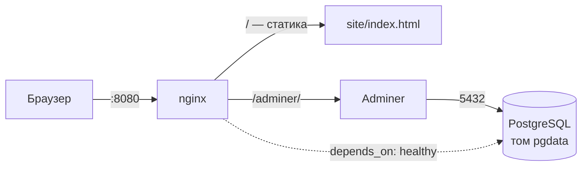

# docker-stand

Стенд на Docker Compose: PostgreSQL, nginx и Adminer — с томами, healthcheck и проверенным восстановлением из бэкапа.

## Что это

Три сервиса в одной сети Docker Compose: nginx, PostgreSQL 16 и Adminer. Наружу открыт только порт 8080 — через него nginx отдаёт статическую страницу и проксирует веб-клиент Adminer по адресу `/adminer/`. Сама база доступна только внутри сети контейнеров, а её данные лежат в именованном томе `pgdata`, поэтому переживают перезапуск и `docker compose down` (том удаляет только `docker compose down -v`).

Стенд учебный. Его задача — отработать резервное копирование и восстановление базы: именно это обычно проверяют на собеседовании по эксплуатации, а не красивый сайт. В репозитории есть база-магазин (24 товара в 3 категориях) и три скрипта: `backup.ps1`, `restore.ps1`, `check.ps1`.

**Это не продакшн.** Пароль в `.env.example` (`change_me`) нужно поменять перед любым использованием вне localhost: база работает под суперпользователем, TLS нет, бэкапы не шифруются.

## Состав



| Сервис | Образ | Порт | Зачем |
|---|---|---|---|
| `nginx` | `nginx:1.27-alpine` | `8080` → `80` | отдаёт статику и проксирует `/adminer/` |
| `db` | `postgres:16-alpine` | `5432`, только внутри сети | PostgreSQL, данные в томе `pgdata` |
| `adminer` | `adminer:4` | `8080`, только внутри сети | веб-клиент к базе через `/adminer/` |

Пунктирная стрелка — не трафик, а зависимость запуска: nginx стартует после того, как `db` станет `healthy`.

## Требования

- Docker Desktop с движком 24 или новее (проверялось на 29.9.3);
- плагин `docker compose`, версия 2 и новее (проверялось на v5.7.0);
- PowerShell 5.1 — только для скриптов из `scripts/`;
- около 1 ГБ свободной оперативной памяти.

Команды `docker compose` работают в любом терминале — PowerShell, cmd, bash. Вспомогательные скрипты `check.ps1`, `backup.ps1` и `restore.ps1` написаны под Windows PowerShell; на Linux или macOS вместо них выполняйте те же `docker compose exec`, `pg_dump` и `pg_restore` вручную.

В Windows политика по умолчанию запрещает выполнение `.ps1`, поэтому все три скрипта запускаются с обходом политики:

```powershell
powershell -ExecutionPolicy Bypass -File .\scripts\backup.ps1
powershell -ExecutionPolicy Bypass -File .\scripts\restore.ps1 -File .\backups\<ваш-дамп>.dump
powershell -ExecutionPolicy Bypass -File .\scripts\check.ps1
```

Без обхода `.\scripts\check.ps1` отвечает `выполнение сценариев отключено`.

## Запуск

```powershell
Copy-Item .env.example .env
docker compose up -d
docker compose ps
```

В bash первая строка — `cp .env.example .env`, остальные команды те же. Первый старт занимает несколько секунд: `nginx` ждёт, пока `db` пройдёт healthcheck.

```text
NAME                     IMAGE                COMMAND                  SERVICE   CREATED          STATUS                    PORTS
docker-stand-adminer-1   adminer:4            "entrypoint.sh docke…"   adminer   17 seconds ago   Up 15 seconds (healthy)   8080/tcp
docker-stand-db-1        postgres:16-alpine   "docker-entrypoint.s…"   db        17 seconds ago   Up 15 seconds (healthy)   5432/tcp
docker-stand-nginx-1     nginx:1.27-alpine    "/docker-entrypoint.…"   nginx     17 seconds ago   Up 10 seconds (healthy)   0.0.0.0:8080->80/tcp, [::]:8080->80/tcp
```

Дальше откройте `http://localhost:8080` — там статическая страница стенда, и `http://localhost:8080/adminer/` — веб-клиент к базе (сервер `db`, логин и пароль из `.env`).

`docker compose down` останавливает стенд, данные в томе `pgdata` сохраняются; `docker compose down -v` удаляет их.

Без `.env` compose не стартует и подсказывает, что делать, — это ожидаемое поведение, а не поломка. Таких строк в выводе четыре, по одной на каждую переменную; первая:

```text
error while interpolating services.db.environment.POSTGRES_DB: required variable POSTGRES_DB is missing a value: Скопируйте .env.example в .env
...
```

## Проверки

```powershell
.\scripts\check.ps1
```

Скрипт делает четыре проверки: все три контейнера запущены, сайт отвечает по HTTP, Adminer отвечает по HTTP, в таблице `products` ожидаемое число строк (по умолчанию 24). Код возврата 0 — всё прошло, иначе 1.

```text
[OK] Все контейнеры запущены: adminer, db, nginx
[OK] Сайт http://127.0.0.1:8080/ — код 200
[OK] Adminer http://127.0.0.1:8080/adminer/ — код 200
[OK] Таблица products: строк 24, ожидалось 24
Итог: 4 из 4 проверок пройдено
```

Проверка данных не декоративная: если база пустая или таблицы нет, четвёртый пункт падает и скрипт возвращает 1.

## Бэкап и восстановление

Дамп снимается одной командой:

```powershell
powershell -ExecutionPolicy Bypass -File .\scripts\backup.ps1
```

`backup.ps1` снимает дамп внутри контейнера `db` (`pg_dump -Fc`), проверяет его там же через `pg_restore -l` и только после этого копирует на хост в `backups/`. Имя файла — метка времени, поэтому старые дампы не перезаписываются, а у вас на машине имя будет своё. Вывод с машины, где снимался дамп:

```text
База: shop, пользователь: shop_user
Создаю дамп внутри контейнера db...
Проверяю дамп (pg_restore -l)...
docker-stand-db-1 Copying docker-stand-db-1:/tmp/backup.dump to .\backups\20261123-153733.dump
docker-stand-db-1 Copied docker-stand-db-1:/tmp/backup.dump to .\backups\20261123-153733.dump
Бэкап: .\backups\20261123-153733.dump (6979 байт)
```

Восстановление берёт конкретный файл. Чтобы не искать имя вручную, возьмите самый свежий дамп:

```powershell
$dump = Get-ChildItem .\backups\*.dump | Sort-Object LastWriteTime | Select-Object -Last 1
powershell -ExecutionPolicy Bypass -File .\scripts\restore.ps1 -File $dump.FullName
```

Если файл известен, укажите его явно: `-File .\backups\<ваш-дамп>.dump`. Скрипт спросит подтверждение, потому что перезаписывает базу; флаг `-Force` его отключает.

Чтобы показать, что восстановление действительно берёт данные из дампа, база была испорчена: схема `public` снесена целиком, вместе с таблицами.

```powershell
docker compose exec -T db psql -U shop_user -d shop -c "drop schema public cascade; create schema public;"
```

```text
NOTICE:  drop cascades to 2 other objects
DETAIL:  drop cascades to table categories
drop cascades to table products
DROP SCHEMA
CREATE SCHEMA
```

После этого `check.ps1` даёт 3 из 4 — данных нет:

```text
[OK] Все контейнеры запущены: adminer, db, nginx
[OK] Сайт http://127.0.0.1:8080/ — код 200
[OK] Adminer http://127.0.0.1:8080/adminer/ — код 200
[FAIL] Данные в базе: psql вернул код 1 — таблица products недоступна
Итог: 3 из 4 проверок пройдено
```

Восстановление (на вопрос подтверждения введено `y`):

```text
Восстановление перезапишет данные в базе 'shop'.
y
Файл: .\backups\20261123-153733.dump
Копирую дамп в контейнер db...
docker-stand-db-1 Copying .\backups\20261123-153733.dump to docker-stand-db-1:/tmp/restore.dump
docker-stand-db-1 Copied .\backups\20261123-153733.dump to docker-stand-db-1:/tmp/restore.dump
Проверяю дамп (pg_restore -l)...
Очищаю схему public...
DROP SCHEMA
CREATE SCHEMA
Восстанавливаю базу...
pg_restore код: 0
Восстановлено: таблица products, строк: 24
```

И `check.ps1` снова проходит целиком:

```text
[OK] Все контейнеры запущены: adminer, db, nginx
[OK] Сайт http://127.0.0.1:8080/ — код 200
[OK] Adminer http://127.0.0.1:8080/adminer/ — код 200
[OK] Таблица products: строк 24, ожидалось 24
Итог: 4 из 4 проверок пройдено
```

`restore.ps1` намеренно не верит коду возврата `pg_restore`: `pg_restore` с флагом `--clean` вообще может вернуть ненулевой код из-за предупреждений об отсутствующих объектах — это свойство самого `pg_restore`, а не особенность этого стенда. Плюс «успех» без проверки данных легко спутать со старыми строками, которые никуда не делись. Поэтому скрипт сначала проверяет, что дамп читается (`pg_restore -l`), затем сам сносит схему `public` и восстанавливает базу, и только потом считает строки в `products`: ноль строк или отсутствующая таблица — провал с кодом 1. Проверено и обратное: дамп только со схемой (`pg_dump --schema-only`) даёт `Fail : Восстановление не удалось: в таблице products 0 строк — данные из дампа не загрузились (pg_restore код 0).` и код 1, а битый файл отсекается ещё до очистки схемы — `Fail : Дамп не читается: pg_restore: error: could not read from input file: end of file`, данные остаются нетронутыми.

## Переменные окружения

Все значения берутся из `.env` в корне проекта; шаблон — `.env.example`.

| Переменная | По умолчанию | Зачем |
|---|---|---|
| `POSTGRES_DB` | `shop` | имя базы; создаётся при первом старте на пустом томе |
| `POSTGRES_USER` | `shop_user` | пользователь базы, он же суперпользователь |
| `POSTGRES_PASSWORD` | `change_me` | пароль; менять до любого использования вне localhost |
| `STACK_PORT` | `8080` | порт на хосте, который слушает nginx |

## Разбор сбоев

| Симптом | Причина | Что делать |
|---|---|---|
| `required variable POSTGRES_DB is missing a value: Скопируйте .env.example в .env` | нет файла `.env` | `Copy-Item .env.example .env` |
| `docker compose up` не может занять порт | порт `8080` уже занят другим процессом | поменять `STACK_PORT` в `.env` и поднять заново |
| контейнер `db` в статусе `unhealthy` | база не прошла `pg_isready`: неверный пароль, повреждённый или занятый том | `docker compose logs db`, проверить `POSTGRES_*` в `.env` |
| `/adminer` без завершающего слэша открывает статику стенда или редиректит без порта | запрос к `/adminer` вместо `/adminer/` | открывать `/adminer/`: nginx отвечает 301 на `/adminer/` с сохранением порта |
| `[FAIL] Данные в базе: psql вернул код 1 — таблица products недоступна` | база пустая, схема снесена | восстановить из дампа: `.\scripts\restore.ps1 -File .\backups\<файл>.dump` |
| `Fail : Дамп не читается: ...` | файл дампа битый или обрезан | взять другой дамп; база при этом не меняется |
| `Fail : Контейнер db не запущен. Выполните: docker compose up -d` | стенд погашен | `docker compose up -d`, затем повторить команду |

## Что дальше

- Отдельный пользователь базы только на чтение для Adminer вместо суперпользователя `shop_user`.
- TLS перед nginx, чтобы пароль и данные не ходили по сети открытым текстом.
- Расписание бэкапов (cron или Планировщик Windows) с ротацией и удалением старых дампов.
- Мониторинг контейнеров и свободного места на томе `pgdata`, чтобы сбой замечал не только `check.ps1`.

Лицензия: MIT.

---
